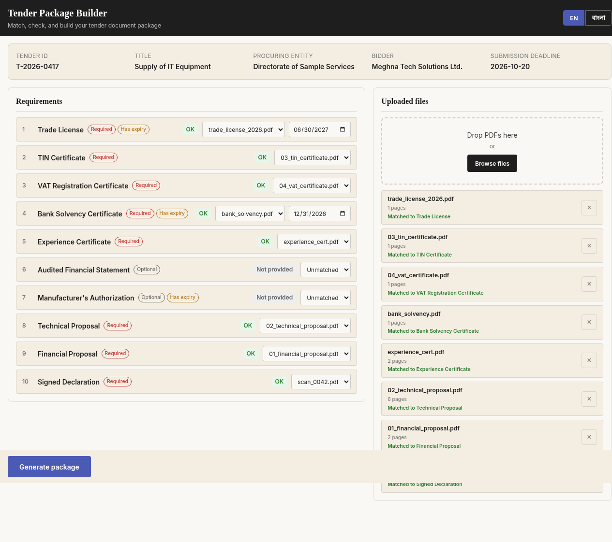
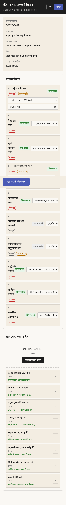

# Tender Package Builder

A frontend-only bilingual (Bangla/English) web app that helps office staff match PDFs to tender requirements, check expiry dates and duplicates, and generate one ordered, page-numbered PDF package.

**Live:** https://ifti136.github.io/devfest-0242310005101143/

## Screenshots

| English | বাংলা |
| --- | --- |
|  |  |

Mobile (360px): [English](screenshots/03-mobile-en.png) · [বাংলা](screenshots/04-mobile-bn.png)

## Features
- Upload up to 30 PDFs (50 MB total)
- SHA-256 content-based duplicate detection
- Match files to requirements (one-to-one)
- Expiry date checking against submission deadline
- 5 statuses: Missing, Expiry date needed, Expired, Not provided, OK
- Generate button disabled while blocking issues exist (with reasons shown)
- PDF generation: English cover + merged docs + `<tender_id> | Page X of Y` footers
- Full Bangla/English toggle (top bar, persists across visits)

## Run locally
```bash
python3 -m http.server 8000
```
Open http://localhost:8000

> The app must be served over HTTP (or GitHub Pages) — ES modules do not run
> from a `file://` URL. The page shows a hint if opened directly as a file.

The requirements pack is loaded from `documents/requirements.json` at runtime,
falling back to embedded sample data if the file is absent.

## i18n check
```bash
node scripts/check-i18n.mjs
```

## Tech stack
- Plain HTML, CSS, vanilla JS (ES modules)
- pdf-lib (PDF merge/footers), pdf.js (page count) via CDN
- Google Fonts: Inter + Noto Sans Bengali
- No framework, no build step, no backend

## Bilingual support
Every user-visible string lives in `js/locales/en.js` and `bn.js`. The language toggle in the top bar switches the entire page without reload and persists to localStorage.

## Structure
```
index.html
css/         tokens.css, base.css, components.css
js/          main.js, i18n.js, app.js
  data/      tender.js (requirements data)
  locales/   en.js, bn.js
docs/        PRD.md, DESIGN.md, I18N_SPEC.md, PLAN.md
scripts/     check-i18n.mjs
output/      generated package PDF
screenshots/ app screenshots
```